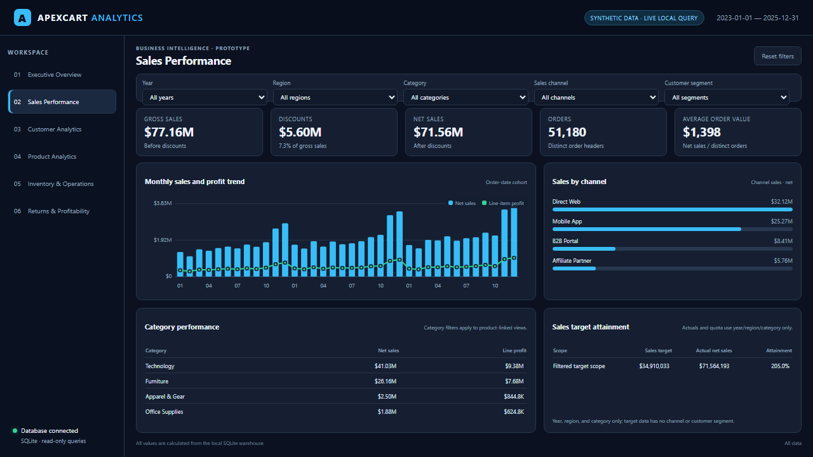
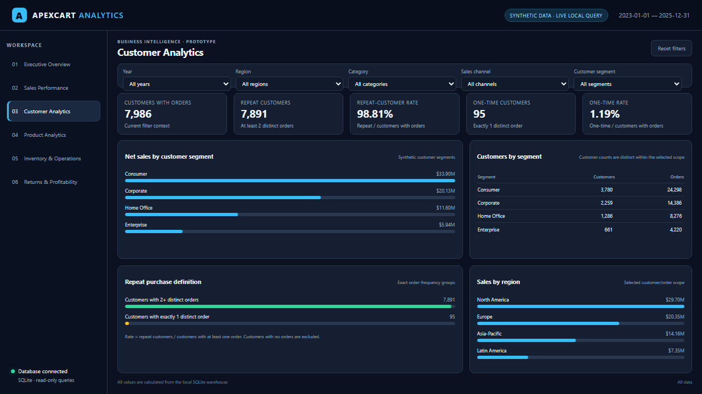
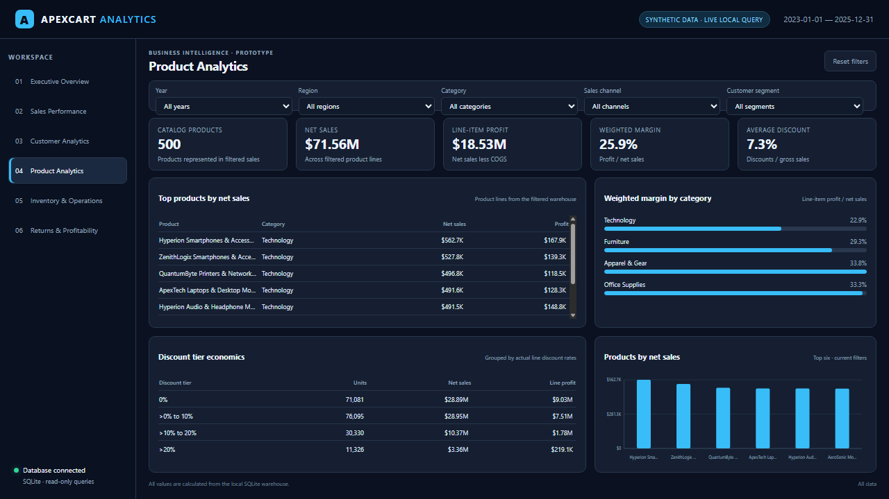
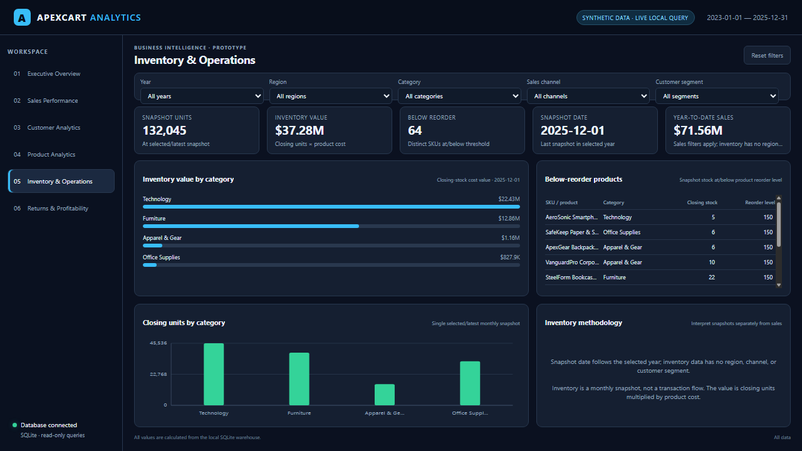
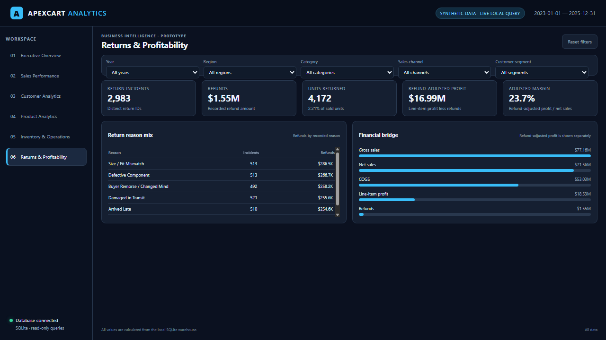
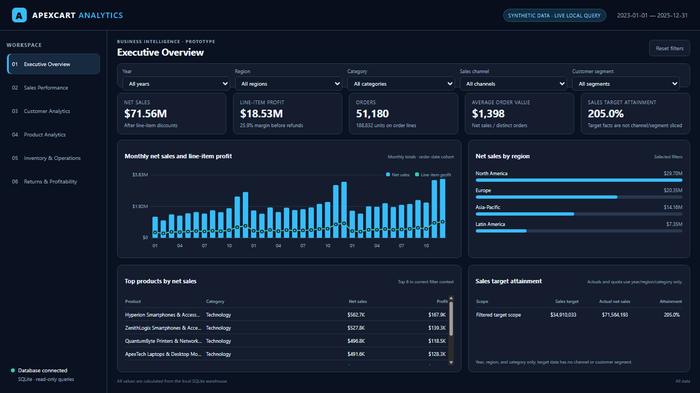

# E-Commerce Sales, Customer & Business Performance Analytics

**ApexCart Retail Inc.** is a synthetic omnichannel retailer used for an end-to-end analytics portfolio project. The repository includes a reproducible raw-to-clean data pipeline, a SQLite warehouse, SQL analysis, a sample-oriented Excel workbook, and a six-page local browser dashboard.

> **Data and implementation note:** all data is synthetic. The interactive dashboard is a local web prototype, not a Power BI report. The included PBIX is an unusable stub and is excluded from the repository; the DAX file is a reference asset, not a tested model.

## Project overview

The project brings sales, order lines, customers, products, returns, inventory snapshots, and sales targets into a consistent analytical workflow. It is designed to explore questions such as:

- How do discounts, cost, and product mix relate to line-item profit?
- Which customers have repeat order headers, and how should that measure be interpreted?
- How do sales and margins vary by product category, channel, and region?
- What return reasons and refund amounts are recorded?
- Which products are at or below their reorder level in the latest inventory snapshot?
- How do stored sales targets compare with line-item net sales?

The workflow is **synthetic source CSVs → Python cleaning and audit → cleaned CSV tables → SQLite warehouse → SQL analysis and validation → Excel sample analysis and full-warehouse KPI summary → local database-backed dashboard and executive report**.

## Business problem and objectives

The analysis is structured around common e-commerce performance questions:

- Revenue growth versus line-item profitability
- Repeat order frequency and one-time order-header customers
- Product and category sales, margin, and discount patterns
- Return incidents, returned units, and recorded refunds
- Inventory reorder exposure and snapshot value
- Regional performance and stored sales target attainment

Objectives:

1. Make the synthetic source data reproducible and document all cleaning decisions.
2. Provide relational tables and reusable SQL for core commercial and operational questions.
3. Surface the measures, definitions, and caveats needed to interpret results correctly.
4. Present the data in a navigable dashboard without changing the analytical business logic.

This dataset does **not** support claims about real customer churn, causal discount elasticity, operating expenses, or projected financial benefits. Those require additional definitions or data.

## Technology

| Technology | Use in this repository |
| --- | --- |
| Python | Synthetic data generation, raw-data cleaning, SQLite loading, validation, Excel workbook generation, and report generation |
| SQLite and SQL | Local analytical warehouse, integrity checks, 32 business-analysis queries, and KPI views |
| Excel | Formula demonstrations on selected samples, plus a separate full-warehouse SQL results sheet |
| HTML, CSS, JavaScript | Six-page local dashboard prototype with database-backed filters |
| Git and GitHub | Version control and portfolio presentation |

Power BI and DAX assets are documented separately as future/reference material; a functioning Power BI model or report is not included.

## Dataset

All warehouse figures below were checked against the current `data/ecommerce_analytics.db`.

| Table | Rows | Description |
| --- | ---: | --- |
| `dim_date` | 1,096 | Calendar dates |
| `dim_region` | 4 | Sales regions |
| `dim_category` | 15 | Product sub-category lookup |
| `dim_product` | 500 | Product catalog |
| `dim_customer` | 8,000 | Synthetic customer records |
| `fact_orders` | 51,180 | Order headers |
| `fact_order_details` | 104,673 | Order lines |
| `fact_returns` | 2,983 | Return incidents |
| `fact_inventory` | 18,000 | Product/month inventory snapshots |
| `fact_sales_targets` | 576 | Monthly region/category targets |

The order-date range is **2023-01-01 through 2025-12-31**. The four defect-injected raw CSVs contain 500 products, 8,080 customers, 52,150 orders, and 106,382 order lines before cleaning. Generated returns are preserved separately in `data/source/fact_returns_generated.csv`.

## Data model

The SQLite warehouse is a star-schema-style relational model:

- `fact_orders` references `dim_date`, `dim_customer`, and `dim_region`.
- `fact_order_details` references order headers and products.
- `fact_returns` references the original order, order line, and product.
- `fact_inventory` stores monthly product snapshots.
- `fact_sales_targets` stores month, region, category, sales, profit, and order targets.
- `dim_product` contains category and sub-category labels; `dim_category` is a separate sub-category lookup.

See [Data_Dictionary.md](documentation/Data_Dictionary.md) and [02_create_tables.sql](sql/02_create_tables.sql) for the exact fields and constraints.

## Data cleaning and validation

`scripts/clean_raw_datasets.py` is the production raw-to-clean path. It leaves the defect-injected raw CSVs unchanged and writes a JSON audit alongside the cleaned files.

| Source | Raw rows | Clean rows | Main verified actions |
| --- | ---: | ---: | --- |
| Products | 500 | 500 | 28 names whitespace-normalized; 10 negative price signs corrected; 17 category labels normalized; 7 missing brands inferred |
| Customers | 8,080 | 8,000 | 80 duplicate rows removed; 253 missing ages filled with raw median age 45; names, gender codes, and segments normalized |
| Orders | 52,150 | 51,180 | 150 duplicates removed; 820 rows rejected for missing customer keys; 2,980 dates and 1,507 status labels normalized |
| Order details | 106,382 | 104,673 | 1,709 lines removed with rejected parent orders; 823 negative quantities corrected; 3,181 text discounts normalized; 560 zero gross-sales values recalculated |
| Generated returns | 3,024 | 2,983 | 41 returns removed because their parent order/line was rejected |

Two of the 822 raw orders with missing customer keys also occur among duplicate rows, so the 150 duplicate removals and 820 rejected missing-key orders produce 970 total rows removed. Inventory and target rows are directly generated clean synthetic sources, not defect-injected raw CSVs.

The SQL runner executes the 32 business-analysis statements and four data-validation statements against the current warehouse; all 36 passed during this audit. See [Data_Cleaning.md](documentation/Data_Cleaning.md) and [Data_Validation.md](documentation/Data_Validation.md) for detail.

## Verified business results

These are descriptive results from the current synthetic warehouse, not forecasts:

| Measure | Result | Definition |
| --- | ---: | --- |
| Gross sales | $77,161,511.63 | Stored order-line gross sales |
| Discounts | $5,597,318.96 | Stored line discount amounts |
| Net sales | $71,564,192.67 | Gross sales less discounts |
| COGS | $53,032,485.66 | Stored order-line costs |
| Line-item profit | $18,531,707.01 | Net sales less COGS; before refunds and operating expenses |
| Line-item margin | 25.90% | Line-item profit / net sales |
| Distinct orders | 51,180 | Order IDs represented by order lines |
| Average order value | $1,398.28 | Net sales / distinct order IDs |
| Customers with order headers | 7,986 | Customers represented in `fact_orders` |
| Repeat-customer rate | 98.81% | 7,891 with 2+ distinct order headers / 7,986 with at least one |
| Recorded refunds | $1,545,024.47 | Sum of `fact_returns.refund_amount` |
| Return-unit rate | 2.21% | 4,172 returned units / 188,832 units on order lines |
| Refund-adjusted profit | $16,986,682.54 | Line-item profit less recorded refunds; not operating profit or EBITDA |
| Aggregate sales-target attainment | 205.00% | Net sales / $34,910,032.51 summed sales targets |

The latest inventory snapshot is **2025-12-01**: 132,045 closing units, $37,282,641.98 at product cost, and 64 SKUs at or below reorder level.

### Interpretation limits

- The warehouse and dashboard sum order-line sales and profit across **all order statuses**, including cancelled orders. The current measures intentionally preserve that existing project logic.
- The repeat-customer calculation counts distinct order headers, including cancelled headers; it is not a completed-purchase retention rate.
- Line-item profit does not subtract refunds. Refund-adjusted profit subtracts recorded refunds only and excludes other operating, fulfillment, and return-handling costs.
- Aggregate sales-target attainment needs status and dimensional-scope review before being used as a performance claim. Targets are stored by month, region, and category; they have no channel or customer-segment fields.
- Inventory is a monthly product snapshot, not a transaction-level flow, and is not sliced by region, channel, or customer segment.

## SQL analysis

`sql/05_business_analysis.sql` contains 32 executable analyses across:

1. Revenue and growth
2. Customer order frequency, RFM, demographics, and repeat-purchase timing
3. Product rankings, category performance, discount bands, and Pareto analysis
4. Regional, channel, payment, shipping, and target performance
5. Returns, inventory, reorder alerts, cancellations, and a financial bridge

Techniques present in the SQL include `JOIN`, `GROUP BY`, conditional `CASE`, CTEs, subqueries, aggregate calculations, and window functions such as `LAG`, `ROW_NUMBER`, `RANK`, `DENSE_RANK`, `NTILE`, and running or moving `SUM`/`AVG` windows. Three KPI views are defined in `sql/06_kpi_queries.sql`. Query descriptions and limitations are in [SQL_Analysis.md](documentation/SQL_Analysis.md).

## Local dashboard prototype

The local HTML/CSS/JavaScript prototype queries the SQLite warehouse in read-only mode. It has six pages: Executive Overview, Sales Performance, Customer Analytics, Product Analytics, Inventory & Operations, and Returns & Profitability. Year, region, category, sales channel, and customer segment filters are available.

The target and inventory sections state their filter limitations in the UI. Screenshots below are captures of this browser prototype, **not Power BI visuals**.














## Excel workbook

`excel/Ecommerce_Analytics.xlsx` preserves the original formula-oriented sample analysis but now labels its sample scope, removes unsupplied business targets, and includes `09_Warehouse_KPIs` with full-warehouse values read from SQLite. Excel formula results are recalculated by Excel when opened; `openpyxl` does not calculate formula caches.

The current executive summary is available as [PDF](reports/Executive_Report.pdf), with its source in [Markdown](reports/Executive_Report.md).

## Power BI status

The file `powerbi/Ecommerce_Business_Analytics.pbix` is a minimal, unusable package stub. It is excluded from Git. The DAX reference file is unvalidated and no Power BI relationships, visuals, or slicers are claimed. See [powerbi/README.md](powerbi/README.md).

## Repository layout

```text
data/
  raw/                 # Preserved defect-injected source CSVs
  source/              # Generated source returns before filtering
  cleaned/             # Cleaned warehouse CSVs and cleaning audit
  ecommerce_analytics.db
dashboard/             # Read-only local dashboard prototype
documentation/         # Requirements, dictionary, cleaning, SQL, validation, insights
excel/                 # Formula/sample workbook with full-warehouse summary
powerbi/               # DAX/theme reference; PBIX stub excluded
reports/               # Executive report in Markdown and PDF
screenshots/           # Six actual browser-dashboard captures
scripts/               # Generation, cleaning, loading, report and test scripts
sql/                   # DDL, checks, analysis, KPI views, validation
```

## Reproduce and run

Requires Python 3.10+; the local dashboard itself uses only the Python standard library.

```powershell
python -m venv .venv
.venv\Scripts\Activate.ps1
python -m pip install -r requirements.txt
python scripts/clean_raw_datasets.py
python scripts/load_sql_database.py
python scripts/test_sql_queries.py
python -m unittest scripts.test_dashboard
python scripts/build_excel_workbook.py
python scripts/build_executive_report.py
python scripts/build_dashboard_gif.py
python dashboard/server.py
```

Open `http://127.0.0.1:8000/` for the dashboard. The synthetic generator is optional: `python scripts/generate_synthetic_data.py` regenerates and **overwrites** the raw synthetic CSVs and generated return source, so do not run it just to rebuild the cleaned data or warehouse.

## Repository hygiene

The `.gitignore` excludes local environments, credentials, temporary outputs, a redundant ZIP bundle, and the unusable PBIX stub. The included data is synthetic. No credentials or real customer data are required to run the project.

## License

Released under the [MIT License](LICENSE).
